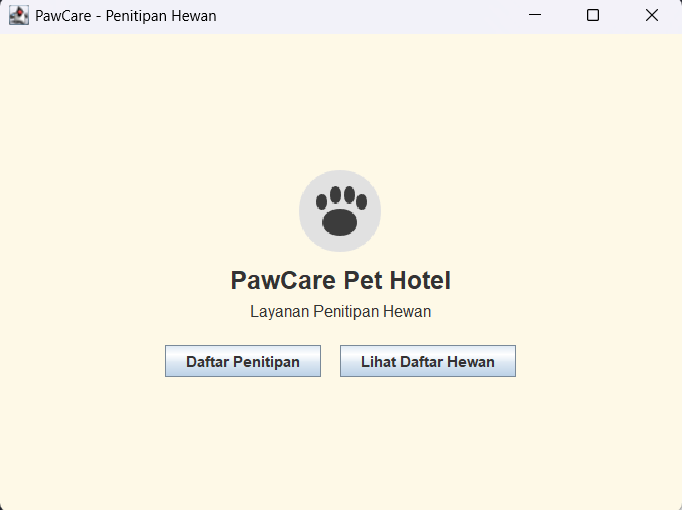
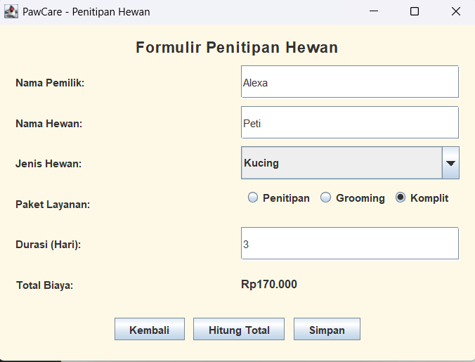
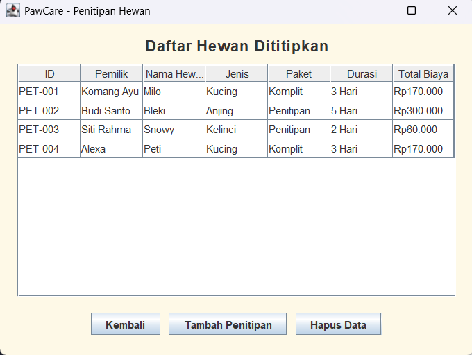
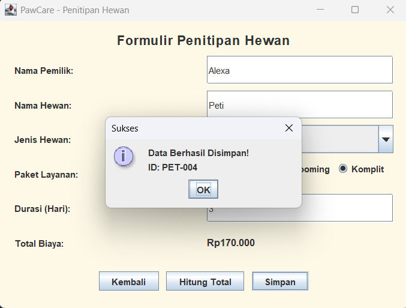
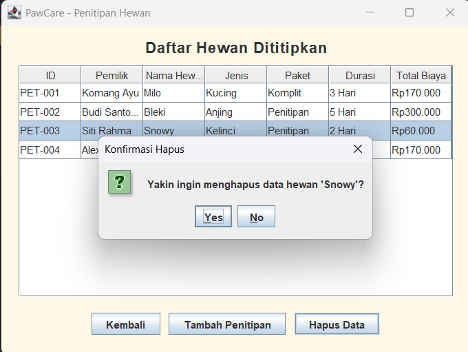
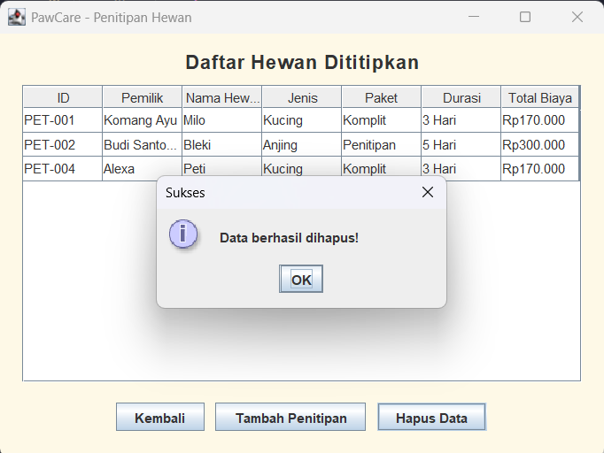

# PawCare - Penitipan Hewan

**Latihan / Eksplorasi GUI pada Java**

> NIM  : **F1D02410084**  
> Nama : **Komang Ayu Sumaitri**  

---

## Deskripsi Aplikasi

**PawCare** adalah aplikasi desktop berbasis Java Swing untuk manajemen penitipan hewan peliharaan. Aplikasi ini dibuat dengan struktur sederhana menggunakan **CardLayout** yang terdiri dari 3 halaman:

1. **Halaman Beranda** (`HalamanBeranda.java`): Menampilkan logo `assets/logo.png`, nama layanan, serta tombol navigasi menuju formulir pendaftaran dan daftar hewan.
2. **Halaman Formulir** (`BookingPanel.java`): Input data pemilik, hewan, jenis hewan, paket layanan, durasi hari, dan tombol hitung total estimasi biaya serta simpan data.
3. **Halaman Daftar Hewan** (`DaftarHewanPanel.java`): Tabel daftar hewan yang sedang dititipkan, tombol tambah data baru, dan tombol hapus data.

---

## 5 Komponen Utama GUI yang Digunakan

### 1. Top-level Container Class
- **`JFrame`** : diimplementasikan pada class `MainFrame.java` sebagai jendela utama aplikasi yang menampung seluruh komponen dan memuat method `main`.



---

### 2. Intermediate Container Class
- **`JPanel`** : digunakan sebagai panel penampung komponen pada `HalamanBeranda`, `BookingPanel`, dan `DaftarHewanPanel`.
- **`CardLayout`** : digunakan pada panel utama di `MainFrame` untuk mengelola perpindahan antar halaman.



---

### 3. Atomic Component Class
- **`JLabel`** : menampilkan teks judul, teks form, dan gambar logo via `ImageIcon`.
- **`JTextField`** : kolom input teks nama pemilik, nama hewan, dan durasi menginap.
- **`JComboBox`** : dropdown pilihan jenis hewan (Kucing, Anjing, Kelinci).
- **`JRadioButton`** & **`ButtonGroup`** : opsi pemilihan paket layanan (Penitipan, Grooming, Komplit).
- **`JButton`** : tombol aksi navigasi, hitung total, simpan data, dan hapus data.
- **`JTable`** & **`JScrollPane`** : tabel penampil data hewan yang terdaftar.


---

### 4. Layout Class 
- **`CardLayout`** : mengatur perpindahan halaman di `MainFrame`.
- **`BorderLayout`** : mengatur tata letak utama pada panel form dan tabel.
- **`GridLayout`** : menyusun kolom form input agar sejajar dan rapi.
- **`GridBagLayout`** : menata logo, judul, dan tombol di beranda agar pas di tengah.
- **`FlowLayout`** : menyusun deretan tombol aksi dan radio button.


---

### 5. Event Listener
- **`ActionListener`** : menangani aksi klik tombol (`addActionListener`) menggunakan lambda:
  - Navigasi antar halaman (`bukaBeranda()`, `bukaBooking()`, `bukaDaftar()`).
  - Perhitungan estimasi total biaya otomatis (`hitungTotal()`).
  - Penyimpanan data hewan ke tabel (`simpanPesanan()`).
  - Penghapusan baris data pada tabel (`hapusData()`).



---

## Dokumentasi Screenshot Aplikasi Lengkap

### 1. Halaman Beranda (Menu Utama)


### 2. Halaman Formulir Pendaftaran & Hitung Biaya


### 3. Pop-up Sukses Pendaftaran


### 4. Halaman Tabel Daftar Hewan Menginap


### 5. Pop-up Konfirmasi Hapus Data


### 6. Pop-up Informasi Berhasil Hapus Data


---

## Struktur File Proyek

```
F1D02410084_Latihan_GUI/
├── assets/
│   └── logo.png                    # Gambar logo aplikasi
├── bin/                            # Hasil kompilasi .class
├── src/
│   ├── MainFrame.java              # Top-level Container (JFrame, CardLayout, & main method)
│   ├── HalamanBeranda.java         # Halaman beranda (logo & menu utama)
│   ├── BookingPanel.java           # Halaman formulir & hitung biaya
│   ├── DaftarHewanPanel.java       # Halaman daftar tabel hewan & hapus data
│   └── Theme.java                  # Warna Buttered Yellow & konfigurasi font
├── screenshot_home.png             # Screenshot Beranda
├── screenshot_FormDaftar.png       # Screenshot Form Pendaftaran
├── screenshot_PopUpSukses.png      # Screenshot Pop-up Berhasil Simpan
├── screenshot_ListDaftar.png       # Screenshot Tabel Daftar Hewan
├── screenshot_PopUpHapus.png       # Screenshot Pop-up Konfirmasi Hapus
├── screenshot_ConfirmOkHapus.png   # Screenshot Pop-up Berhasil Hapus
└── README.md
```

---

## Cara Menjalankan

```bash
# Kompilasi
javac -d bin src/*.java

# Jalankan Aplikasi
java -cp bin MainFrame
```

---
